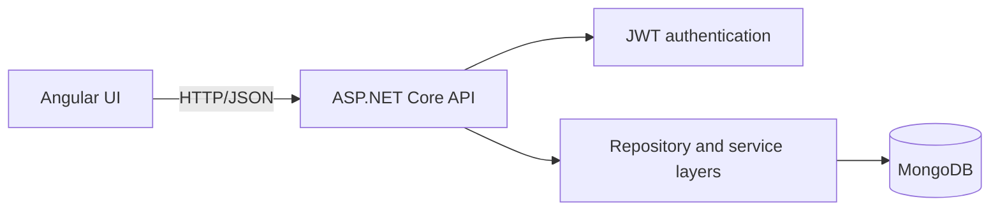

# Learning Management System

A learning-management API and Angular client for managing courses and users. The backend is an ASP.NET Core 6 Web API with MongoDB persistence and JWT-based authentication. The frontend is an Angular 15 application served through Nginx in production.

## Architecture



The API is organized as controllers, services, repositories, and a MongoDB context. Configuration is supplied through ASP.NET Core configuration providers. Secrets are never stored in the repository.

## Technology stack

- .NET 6 and ASP.NET Core Web API
- MongoDB
- JWT bearer authentication and role-based authorization
- Angular 15, Angular Material, RxJS, and Nginx
- Docker Compose for local MongoDB and API execution
- NUnit and Moq for automated tests

## Run locally

Prerequisites: .NET 6 SDK, Node.js 18+, npm, and MongoDB, or Docker with Compose.

```bash
cp .env.example .env
# Edit .env and replace JWT__SECRETKEY with a random value of at least 32 characters.
set -a && . ./.env && set +a
dotnet restore WebSvc/LMS.Api/LMS.Api.sln
dotnet run --project WebSvc/LMS.Api/LMS.Api/LMS.Api.csproj
```

The API is available at the URL printed by ASP.NET Core. In Development, Swagger is available at `/swagger` and the unauthenticated liveness endpoint is `/health`.

Alternatively, run the API and MongoDB together:

```bash
cp .env.example .env
# Set JWT__SECRETKEY in .env first.
docker compose up --build
curl http://localhost:8080/health
```

Run the Angular client separately:

```bash
cd WebUI/LMS-UI
npm ci
npm start
```

## Configuration

ASP.NET Core maps nested environment variables using double underscores:

| Variable | Purpose |
| --- | --- |
| `DBCONFIGURATION__CONNECTIONSTRING` | MongoDB connection string |
| `DBCONFIGURATION__DATABASENAME` | MongoDB database name |
| `JWT__ISSUER` | JWT issuer and audience |
| `JWT__SECRETKEY` | Required signing key, at least 32 characters |
| `JWT__EXPIRATIONINMINUTES` | Token lifetime |

For deployed environments, use the platform's secret manager or environment configuration. Do not commit `.env` files or real credentials.

## API surface

- `GET /health` — liveness check
- Course and user endpoints are exposed through the controllers under `WebSvc/LMS.Api/LMS.Api/Controllers`.
- In Development, use Swagger at `/swagger` for the generated request and response schemas.

## Test and quality checks

```bash
dotnet test WebSvc/LMS.Api/LMS.Api.sln --collect:"XPlat Code Coverage"
cd WebUI/LMS-UI
npm ci
npm run build
npm test -- --watch=false --browsers=ChromeHeadless
```

The GitHub Actions workflow runs backend tests, frontend build/tests, dependency vulnerability checks, and repository secret scanning on every pull request.

## Security

See [`SECURITY_REVIEW.md`](SECURITY_REVIEW.md) for the current threat review and remediation status. Report suspected vulnerabilities privately rather than opening a public issue.
